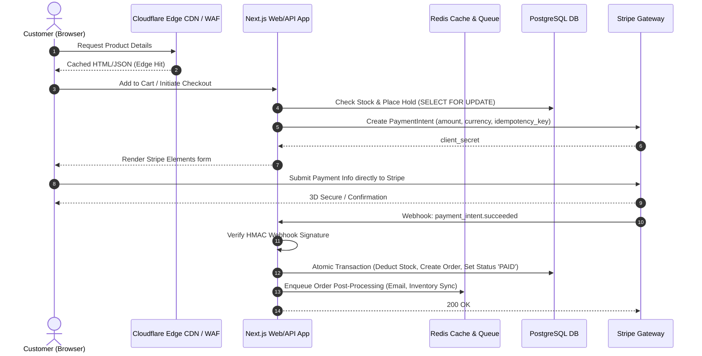

# E-Commerce Cloud & Tech Stack Architecture Specification

## 1. Executive Summary & Architecture Philosophy
This architecture is designed for a modern, scalable, high-performance, and secure e-commerce application. It emphasizes:
- **Separation of Concerns & Modularity**: Decoupled storefront and headless backend/API, or modern unified full-stack SSR/edge architectures.
- **Transactional Integrity & ACID Compliance**: Strict consistency for inventory, ledger, order processing, and payment states.
- **Fast Global Edge Delivery**: Sub-100ms static asset and cached product catalog latency via global CDNs.
- **Zero-Trust Security & PCI-DSS Scope Minimization**: SAQ A compliance via client-side payment tokens (Stripe Elements) and encrypted webhook processing.
- **Automated CI/CD & Infrastructure as Code (IaC)**: Deterministic, repeatable deployments with preview environments and zero-downtime rolling/canary rollouts.

---

## 2. Recommended Tech Stack Matrix

We offer a **Tier 1 (Flagship Modern Next.js Full-Stack)** architecture for optimal speed-to-market and performance, and a **Tier 2 (Decoupled Microservice / Headless)** option for high-scale enterprise operations.

### 2.1 Tier 1: Modern Full-Stack (Recommended Default)
- **Frontend / Storefront**: **Next.js 14/15 (React, TypeScript, App Router, Tailwind CSS, shadcn/ui)**.
  - *Key Features*: Server-Side Rendering (SSR) for SEO-sensitive product and category pages; Incremental Static Regeneration (ISR) for fast caching of product listings; React Server Components (RSC) to reduce client JavaScript bundle size.
  - *State Management*: Zustand or React Query / TanStack Query for client state; Server Actions for optimistic mutations.
- **Backend API & Business Logic**: **Node.js (TypeScript) with Next.js Server Actions / Route Handlers OR NestJS / Express.js**.
  - *Framework*: NestJS or Express/Fastify if separated; or integrated Next.js API route handlers for single-repository agility.
  - *Validation*: Zod for runtime request validation and end-to-end type safety.
- **ORM / Database Abstraction**: **Prisma ORM** or **Drizzle ORM**.
  - Drizzle offers zero-overhead, type-safe SQL queries and fast cold-start performance in serverless/edge runtimes.
  - Prisma offers rich migrations, visual schema modeling, and robust relationship management.
- **Primary Database**: **PostgreSQL 16+** (Hosted on AWS RDS, Supabase, or Neon Serverless Postgres).
  - *Data Modeling*: Strict relational schemas with foreign keys, JSONB for flexible product attributes, row-level locking (`SELECT ... FOR UPDATE`) during inventory reservations.
  - *Connection Pooling*: PgBouncer or Supabase connection pooling to prevent connection exhaustion.
- **Caching & Ephemeral Store**: **Redis (AWS ElastiCache or Upstash Redis)**.
  - Product catalog caching, session token store, rate limiting counters (Token Bucket / Leaky Bucket), cart synchronization, and idempotency key locks.
- **Message Broker / Background Worker**: **BullMQ (Redis-backed)** or **RabbitMQ / AWS SQS**.
  - Asynchronous order fulfillment pipelines, transactional email dispatch (Resend / SendGrid), PDF invoice generation, search index updates.
- **Payment Processing**: **Stripe (Stripe Checkout & Stripe Elements)**.
  - Direct tokenization via Stripe Elements; webhook processing with cryptographic signature verification (`stripe-signature`) and database transaction isolation.

---

## 3. Detailed Component Architecture

### 3.1 Data Flow & Checkout Lifecycle Diagram



### 3.2 Payment Gateway Integration & Security (Stripe)
- **PCI-DSS SAQ A Minimization**: Card details are entered into Stripe-hosted iframes (Stripe Elements) or Stripe Checkout redirect. The e-commerce backend never sees or stores PAN (Primary Account Numbers) or CVVs.
- **Idempotency**: All payment calls and webhook listeners use unique `idempotency_key`s (e.g., `order_uuid + cart_version`) to eliminate duplicate charges.
- **Webhook Replay Protection**: Webhook timestamp verification against clock drift (Stripe default 5-minute tolerance) and unique event ID de-duplication in PostgreSQL/Redis.

---

## 4. Deployment & DevOps Architecture

### 4.1 Multi-Environment Cloud Strategy

#### Option A: Managed PaaS (High Productivity, Lean Ops)
- **Frontend & App**: Vercel (Edge Network + Serverless Functions) or Render / Fly.io for persistent Docker containers.
- **Database**: Managed PostgreSQL on Neon / Supabase / AWS RDS.
- **Redis**: Upstash Redis (Serverless) or Redis Cloud.
- **DNS & WAF**: Cloudflare (SSL/TLS termination, DDoS protection, bot mitigation, edge cache).

#### Option B: Containerized Cloud Native (AWS ECS / EKS or GCP Cloud Run)
- **Compute**: AWS ECS Fargate or GCP Cloud Run (Serverless containers, zero server management, auto-scaling from 1 to N instances).
- **Load Balancer**: AWS Application Load Balancer (ALB) with AWS Certificate Manager (ACM) for free auto-renewing SSL/TLS 1.3 certificates.
- **Database**: AWS Aurora PostgreSQL Serverless v2 with multi-AZ replication.
- **Caching**: AWS ElastiCache for Redis (Cluster mode enabled).
- **Static Assets / Media**: AWS S3 + AWS CloudFront (CDN) with Origin Access Control (OAC).

### 4.2 Docker Containerization (`Dockerfile`)
Multi-stage build Dockerfile optimizing image footprint (< 150MB) and non-root execution:

```dockerfile
# Multi-stage Dockerfile for Next.js / Node.js
FROM node:20-alpine AS base
WORKDIR /app
RUN apk add --no-cache libc6-compat

FROM base AS dependencies
COPY package.json package-lock.json ./
RUN npm ci

FROM base AS builder
COPY --from=dependencies /app/node_modules ./node_modules
COPY . .
ENV NEXT_TELEMETRY_DISABLED=1
RUN npm run build

FROM node:20-alpine AS runner
WORKDIR /app
ENV NODE_ENV=production
ENV PORT=3000
RUN addgroup --system --gid 1001 nodejs && adduser --system --uid 1001 nextjs
COPY --from=builder /app/public ./public
COPY --from=builder --chown=nextjs:nodejs /app/.next/standalone ./
COPY --from=builder --chown=nextjs:nodejs /app/.next/static ./.next/static
USER nextjs
EXPOSE 3000
CMD ["node", "server.js"]
```

### 4.3 CI/CD Pipeline (GitHub Actions)
Fully automated continuous integration and continuous deployment pipeline:
1. **Lint & Static Analysis**: ESLint, Prettier, TypeScript type check (`tsc --noEmit`).
2. **Security & Vulnerability Scans**: `npm audit`, Snyk / Trivy container image scanning, GitGuardian secret scanning.
3. **Automated Testing**: Unit tests (Vitest/Jest), integration tests (Supertest/Node test runner), end-to-end tests (Playwright).
4. **Build & Container Push**: Build Docker image, tag with Git SHA, push to Amazon ECR / GitHub Packages (GHCR).
5. **Database Migration Step**: Run `prisma migrate deploy` or `drizzle-kit migrate` in an isolated pre-deploy step.
6. **Zero-Downtime Rollout**: Blue/Green or Rolling update on ECS Fargate / GCP Cloud Run / Vercel preview & production promotion.

---

## 5. Infrastructure as Code (IaC) - Terraform Module Layout
Modular Terraform structure for reproducibility:
- `modules/network`: VPC, public/private subnets across 2+ Availability Zones, NAT Gateways, Security Groups.
- `modules/database`: Aurora PostgreSQL / RDS cluster, subnet groups, KMS encryption at rest.
- `modules/compute`: ECS Fargate cluster, task definitions, auto-scaling policies (CPU & Memory target tracking).
- `modules/edge`: CloudFront CDN distribution, S3 media bucket, Cloudflare DNS records & WAF rules.

---

## 6. Production Readiness Checklist

| Category | Requirement | Implementation Specification |
| :--- | :--- | :--- |
| **Monitoring & Metrics** | Real-time APM & Infrastructure | Datadog or Prometheus + Grafana; monitoring p95/p99 response latency, HTTP 5xx error rate, DB connection pool saturation. |
| **Logging** | Structured Centralized Logging | Winston or Pino logger outputting JSON with correlation IDs (`x-request-id`); aggregated via AWS CloudWatch / Datadog / Better Stack. |
| **Error Tracking** | Real-time Exception Tracking | Sentry with release tagging, source map uploads, and Slack alert integrations for uncaught exceptions. |
| **Backups & DR** | Database Recovery | Point-in-time recovery (PITR) with automated continuous WAL archiving (e.g. AWS RDS 35-day retention); daily snapshot export to cold S3 storage. |
| **Health Checks** | Liveness & Readiness Probes | `/healthz` (liveness) and `/ready` (readiness probing DB and Redis connections). |
| **Security & Headers** | OWASP Top 10 Hardening | Content Security Policy (CSP), HSTS (`max-age=63072000; includeSubDomains; preload`), CORS restrictions, rate limiting per IP/token. |
| **Graceful Shutdown** | Zero-drop connection handling | Handling `SIGTERM`/`SIGINT` by stopping incoming HTTP requests and draining active DB/Redis transactions within a 30s timeout. |

---

## 7. Turnkey Recommendations for Rapid Execution
1. **Quickest Launch Path**: Next.js App Router deployed on **Vercel** + **Supabase PostgreSQL** + **Upstash Redis** + **Stripe**.
2. **Enterprise / Self-Hosted Path**: Next.js Dockerized on **AWS ECS Fargate** or **GCP Cloud Run** + **AWS RDS PostgreSQL** + **AWS ElastiCache** + **Cloudflare**.
