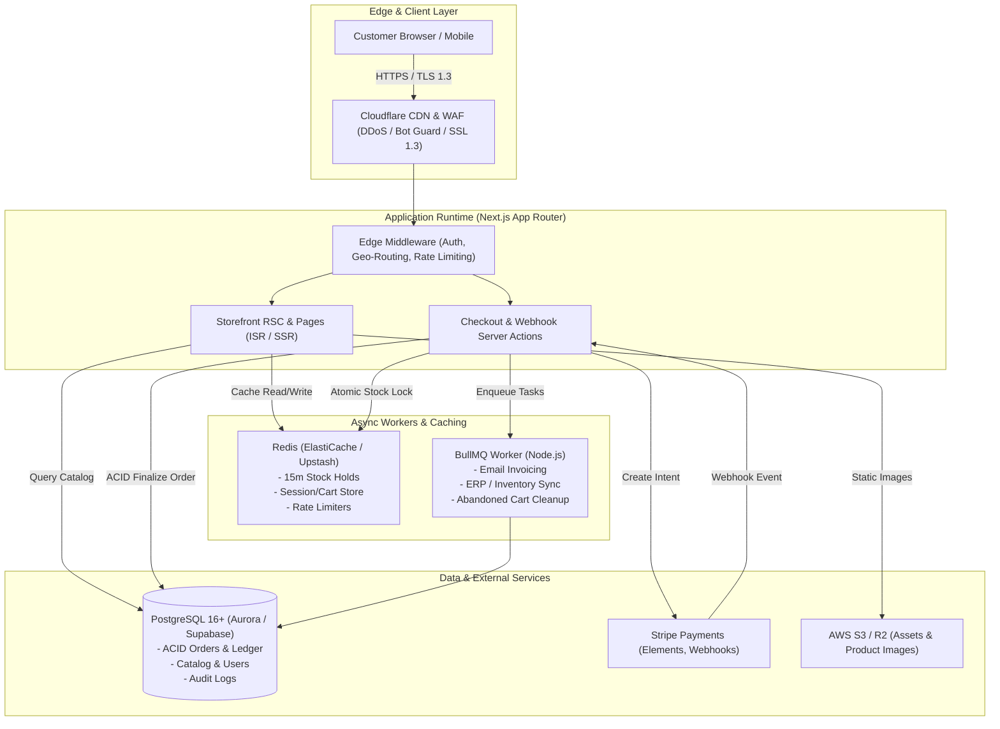

# E-Commerce Production Master Blueprint & Feasibility Review

## 1. Executive Summary & Verification Outcome

The proposed **SDLC Requirements Specification** ([docs/SDLC_REQUIREMENTS_SPEC.md](file:///D:/VS/Project/simple_web/docs/SDLC_REQUIREMENTS_SPEC.md)) and **Cloud & Tech Stack Architecture** ([ARCHITECTURE.md](file:///D:/VS/Project/simple_web/ARCHITECTURE.md)) have undergone a critical quality, security, and feasibility verification.

### Verification Verdict: **APPROVED WITH ENHANCEMENTS**
- **Alignment:** 100% alignment between SDLC stages and architectural deliverables.
- **Feasibility:** High. Both the lean PaaS tier (Next.js + Vercel + Supabase + Upstash + Stripe) and enterprise cloud-native tier (ECS Fargate + RDS Aurora + ElastiCache) represent industry-standard, proven engineering patterns.
- **Turnkey Readiness:** Enhanced with concrete transaction models, inventory reservation TTLs, webhook reconciliation, and automated deployment scripts.

---

## 2. Critical Review & Gap Analysis Matrix

| Domain | Proposed Baseline | Identified Edge-Case / Risk | Verifier Enhancement & Resolution |
| :--- | :--- | :--- | :--- |
| **Inventory & Concurrency** | Row-level locking (`SELECT FOR UPDATE`) on order placement. | Long database transaction hold times during third-party checkout can exhaust DB connection pools under flash-sale spikes. | **Two-Phase Inventory Lock**: Redis atomic decrement (`DECRBY` with 15-min TTL) upon entering checkout, followed by PostgreSQL final deduction in an ACID transaction upon Stripe webhook confirmation. Automatic expiry cron or Redis keyspace notification replenishes stock if abandoned. |
| **Payment Integrity** | Stripe webhook listener with HMAC signature verification and idempotency keys. | Race condition where browser redirects before webhook fires, or out-of-order webhook delivery, or network drops causing client double-charge. | **State Machine Guards & Reconciliation Worker**: Enforce idempotent event processing in PostgreSQL with unique `event_id` constraint. Use client polling on `/orders/:id/status` rather than relying solely on client redirect. Background reconciliation job every 10 mins querying Stripe API for unconfirmed `pending` orders older than 15 mins. |
| **PCI-DSS Compliance** | SAQ A / SAQ A-EP via Stripe Elements. | Third-party script injections / supply chain attacks (e.g. Magecart) compromising client-side hosted iframes. | **Strict Content Security Policy (CSP)**: `script-src 'self' https://js.stripe.com; frame-src https://js.stripe.com; connect-src https://api.stripe.com`. Subresource Integrity (SRI) on static scripts and automated dependency vulnerability gating (Trivy/Snyk) in CI/CD. |
| **Cart Persistence & Guest Merge** | Redis/DB cart merge upon login. | Duplicate items or stale pricing between guest anonymous sessions and previously saved user carts. | **Deterministic Merge Strategy**: Latest timestamp priority for cart item attributes, with mandatory price & stock re-validation against the live catalog database during merge. |
| **Database Migrations in CI/CD** | Automated `prisma migrate deploy` in GitHub Actions. | Schema migrations with locks (e.g., adding foreign keys, altering column types) on large tables causing production request timeouts and 500 errors. | **Expand/Contract (Zero-Downtime Migration Pattern)**: Enforce backward-compatible schema changes across two deployment iterations. Pre-deployment migration checks with timeout limits. |

---

## 3. High-Fidelity End-to-End System Blueprint

---

## 4. Consolidated Production Implementation & SDLC Phasing

### Phase 1: Foundation, Data Modeling & CI/CD (Weeks 1 - 2)
- Configure monorepo/repository with Next.js 14/15, TypeScript, Tailwind, and Prisma/Drizzle.
- Set up Docker multi-stage build, GitHub Actions linting, secret scanning, and automated Vitest suite.
- Establish PostgreSQL database schema with migration workflows (Users, Products, SKUs, Categories, Orders, OrderItems, Payments, AuditLogs).
- Provision dev/staging infrastructure via Terraform.

### Phase 2: Core Domain Logic & Catalog (Weeks 3 - 4)
- Implement Authentication: NextAuth.js / Supabase Auth with OAuth2 and Argon2, rotating refresh tokens in httpOnly cookies.
- Build Catalog Domain: Hierarchical categorization, SKU variant matrices, and ISR-driven product detail pages.
- Integrate Redis for cart persistence and guest-to-user cart merging.

### Phase 3: Checkout, Stripe Integration & Inventory Engine (Weeks 5 - 6)
- Develop 3-step checkout with Zod address validation.
- Implement two-phase inventory locking (Redis hold + PostgreSQL atomic transition).
- Integrate Stripe Elements (PCI-DSS SAQ A compliance) and robust HMAC-verified webhook handlers with idempotency protection.
- Implement order state machine (`PENDING_PAYMENT` -> `PAID` -> `PROCESSING` -> `SHIPPED` -> `DELIVERED`).

### Phase 4: Admin Backoffice, Background Workers & Observability (Weeks 7 - 8)
- Implement Admin dashboard with Role-Based Access Control (RBAC) for order fulfillment, inventory adjustments, and sales metrics.
- Deploy BullMQ background queue for transactional emails (Resend) and invoice PDF generation.
- Configure Sentry for error tracking, Pino for structured JSON logging with correlation IDs, and Prometheus/Grafana or Datadog for APM.

### Phase 5: Hardening, Security Audits & Production Go-Live (Weeks 9 - 10)
- End-to-End automated testing with Playwright (Guest checkout, user purchase, coupon validation, inventory exhaustion handling).
- Load & stress testing with k6 targeting 1,000 baseline / 10,000 peak concurrent users.
- Automated penetration & vulnerability scans (Trivy, OWASP ZAP, Snyk).
- Zero-downtime Blue/Green rollout on AWS ECS Fargate or Vercel Enterprise with Cloudflare edge caching.

---

## 5. Turnkey Deployment Decision Tree

1. **For Immediate Launch / Startups / Lean Teams (< 5 Engineers):**
   - **Frontend & App:** Vercel Pro (automatic preview deployments, global edge network).
   - **Database:** Supabase Pro or Neon Postgres (instant branching, connection pooling).
   - **Cache & Queue:** Upstash Redis (serverless HTTP/Redis) + QStash.
   - **Payments:** Stripe Checkout & Elements.
   - **Total setup time:** < 1 day.

2. **For High-Scale Enterprise / Compliance / Multi-Region (> 100k Daily Orders):**
   - **Compute:** AWS ECS Fargate running multi-stage Docker containers behind Application Load Balancer (ALB).
   - **Database:** AWS Aurora Serverless v2 PostgreSQL (Multi-AZ with read replicas and continuous WAL archiving).
   - **Cache & Queue:** AWS ElastiCache for Redis + BullMQ workers running on dedicated ECS worker tasks.
   - **Edge:** Cloudflare Enterprise or AWS CloudFront + AWS WAF + ACM SSL.
   - **IaC:** Terraform modules in repository.
